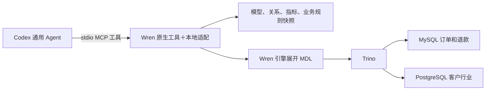

# W2：让 Codex 使用同一份业务语义问数

本步已实际完成，待 review，未提交。W1 已提交为 `7e6d467`。先读本教程，再对照 [README 操作记录](README.md#w2-codexwren-mcp-实际记录2026-10-18)。以下命令均在 `deployment/008_first_bi_prototype` 执行；需要 S2～S4 的现有容器与数据卷，不会替你初始化生产数据库。

## 1. 先看清数据经过什么



Codex 负责理解问题和选择工具；MCP 负责传递请求；Wren 模型负责可执行关系。中文规则帮助解释“净收入”的含义，但退款先聚合、客户用复合键关联，必须落实在模型中。Superset 继续使用 S4 数据集，没有自动消费这份 Wren 模型。

这次没有开发新 Agent。适配脚本只处理固定版本工具的缺口，不编排对话。服务由 Codex 启动为子进程，经标准输入输出通信，无新增 HTTP 端口；客户端结束后子进程退出，不需要再启动一个常驻 Wren 服务。

## 2. 安装并连接：服务端和客户端是两件事

```bash
python3 scripts/install_w2.py
.local/codex-bin mcp list --json
```

安装器复用 W1 的本地虚拟环境，使用 65 包锁文件，保留 W1 的 48 个固定依赖。关键版本是 `wrenai==0.16.0`、`wren-core-py==0.8.1`、`mcp==1.26.0`。首次解析得到 MCP 2.3.0 时，Wren 导入 `mcp.server.fastmcp` 失败，因此不能只写“安装最新 MCP”。

安装器还会 validate/build，并生成**本原型目录**的 `.codex/config.toml`；仓库根 `.codex/` 和用户全局配置不改。可提交模板在 [mcp.example.toml](codex/mcp.example.toml)，绝对路径由脚本按实际目录生成，本机配置被 Git 忽略。配置不同会报错供检查，不会直接覆盖已有同名入口。

`mcp list` 只证明客户端读取了配置，不能证明模型已调用工具。实际调用证据在后面的 Codex 验证中。已有 Codex 客户端可能需要重新打开会话才能加载新增 MCP；从本目录启动新 CLI 会话已实测成功。无需为了每条命令反复重启。

客户端仅启用 12 个发现、规划、只读查询工具；服务端保留 17 个原生只读工具并加一个 `get_runtime_contract`，共 18 个。服务端没有注册 `store_query`。`default_tools_approval_mode="approve"` 是该入口的工具审批设置，不等于数据库权限；客户端组织策略仍可能另有限制。[官方配置说明](https://developers.openai.com/codex/mcp)

## 3. 先用固定 MCP 调用确认能力

```bash
.local/wren-venv/bin/python scripts/verify_w2_mcp.py
```

这是真实 MCP 客户端，不是直接调用 Python 函数来冒充 MCP。它启动服务、握手、发现工具，然后读取规则、模型、cube、知识资源与工作流 prompt。`get_context` 在未安装向量检索扩展时能回退为完整 schema；不要把 W1 的 CLI `memory fetch` 失败推断成全部 MCP 上下文不可用。

接下来依次测试 dry-plan、dry-run、查询、cube 和错误输入。检查 [固定调用证据](evidence/w2-mcp-verification.json) 的 baseline，而不是 calls 中某个同名工具的最后一次返回。

| 你要理解的点 | 实测事实 |
| --- | --- |
| 同一语义是否落在执行中 | 总额 245，行业软件 120/零售 125，日期 10-01 120/10-02 125 |
| 金额会不会在工具协议中变成浮点 | `9007199254740993.01` 原样以字符串返回；用 Decimal 对账 |
| 返回行数限制是否可见 | limit=1 返回一行且 truncated=true；这不代表扫描成本受限 |
| 能否绕过模型查物理表 | 三个入口各 10 个非法请求被适配器拒绝，拒绝前后原生 query 调用计数未增加 |
| 语义变动后旧进程是否继续执行 | 临时副本规则变化后报告 revision 不一致；元数据仍是启动快照，查询被拒绝 |

最后一项只是防止混用版本，不是变更发布系统；真正的发现、审核、发布、回滚留在 W3。fixture 使用临时目录，没有改动实时业务表。

## 4. 再让 Codex 自己问数

```bash
python3 scripts/verify_w2_codex.py
python3 scripts/verify_w2_codex.py --case ambiguity
python3 scripts/verify_w2_codex.py --case synonym
```

脚本使用本机已安装并登录的 Codex CLI 0.163.0，继承现有模型配置，没有复制登录凭据。问数测试禁用 shell 和 multi_agent，使用只读文件沙箱，只允许调用这一个 MCP；它作为产品被测试，不参与开发部署。原始会话日志写入被忽略的 `.local/`，review 证据只保留 MCP 调用和最终答案。

第一条问题要求固定 10 月窗口的总额、行业、按日结果。实测 15 次 MCP 调用：运行契约和规则、模型/cube 发现和详情、三次 dry-plan、三次 dry-run、三次 run_sql。验收脚本逐条检查工具结果和最终答案，不接受只照抄 README 的预期数值。

第二条问“公司的收入怎么样？”。实测只读契约和规则两次，随后询问时间、收入口径和分析方式，没有运行 SQL。这说明这一次实验中模型使用了语义澄清规则，不保证所有问法都正确。第三条将问题中的“净收入”改为受控别名“净销售额”，实测同样通过 15 次 MCP 调用取得相同结果。尚未做大规模同义词或随机问法评估。

你也可以启动交互会话：

```bash
.local/codex-bin -C "$PWD"
```

先用 `/mcp` 查看 `bi008_wren`，然后问：

> 只用 bi008_wren。先读运行契约和业务规则，再查 2026-10-01 至 2026-11-01 前的净收入，按当前行业和订单日分组。先检查计划再执行，说明口径和模型版本。

观察它是否发现 `bi_orders`、是否使用 DATE 字面量、是否说明行业是当前行业和退款归属订单日。不要只检查最后的 245。

## 5. 为什么没有直接启动原生 Wren MCP

W1 已发现限定名可能绕过同名模型展开；原生 strict_mode 不是完整的业务授权。适配器在三个 SQL 入口解析 AST，拒绝 catalog/schema 限定名、多语句、修改语句和表函数，并继续调用原生严格策略验证模型名与 CTE。Wren 自己展开的后端物理引用不属于用户输入。

还关闭 fallback，防止语义规划失败后尝试直接执行。模型、规则和配置形成启动版本指纹；源文件变化后拒绝执行。Decimal 在当前进程序列化为精确字符串，不修改安装包源码。适配依赖固定版本的内部 API，升级必须回归。

这修补了**本 MCP 入口的已测路径**，没有修复原生 CLI/SDK，也不等于生产安全审计。Trino 目前未建立可信的部门身份链；客户端只读沙箱不会替 MCP 下游提供行级权限。部署会话不能用来证明 A/B 员工已隔离。

## 6. 日期区间失败时怎么操作

原生 cube 日期区间会将 DATE 与 varchar 比较，Trino 报 TYPE_MISMATCH，见 [保留的失败](evidence/w2-native-cube-range-failure.json)。当前适配入口明确返回 `BI008_CUBE_RANGE`。无区间 cube 聚合/日期分组已通过；有固定时间窗口时使用：

```sql
SELECT order_date, SUM(net_amount) AS net_revenue
FROM bi_orders
WHERE order_date >= DATE '2026-10-01'
  AND order_date < DATE '2026-11-01'
GROUP BY order_date
ORDER BY order_date
```

调用顺序是 dry_plan → dry_run → run_sql。金额仍使用 W1 的显式 DECIMAL CAST 约定，不能因为 MCP 返回精确字符串就认为上游所有金额翻译都正确。

## 7. 核对、停止与恢复

```bash
.local/wren-venv/bin/python scripts/finish_w2.py
```

该脚本核对 W1 MDL、48 个依赖、源指纹证据、语义版本和 Superset 原有资产。源指纹证据来自实际重新执行的 `source_db.py verify`；它包含只读账号拒绝测试和回滚的数据约束测试，执行需要 Docker 权限，不是线上定时检查器。

Superset 仍是 `http://192.168.2.46:8088/superset/dashboard/1/`，图表 1/2/3、S4 数据集 SQL 未变。退出 Codex 即停止该 stdio 服务；恢复时保证现有 Trino 和源数据库可用，再启动新 Codex 会话。若 revision 不一致，先核对变更、validate/build、回归并 review，再重新打开客户端；不要绕过检查改连原始源。

本步停在 review，不做 Git 提交，不进入 W3。部门隔离、自动发布、Superset 同步、向量检索、生产容量仍未验收。
