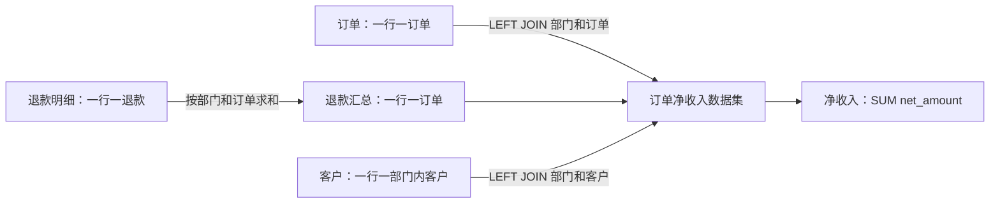

# 业务关系、语义上下文与增长实验

状态：语义层设计仍是草案，MDL 与 Agent 接入尚未实现。S2 已将主键、退款复合外键、金额检查等部分规则落地，并加入跨库引用及退款累计的程序校验；具体执行位置与边界见 [数据字典](DATA-DICTIONARY.md)，实测见 [S2 证据](evidence/s2-sources.json)。

## 第一课：为什么知道列名仍然会算错

订单 1 实付 100，有两笔退款 10 和 20。直接 JOIN 退款后产生两行，若计算 `SUM(paid_amount - refund_amount)`，得到 90＋80＝170，正确值应为 70。问题不是 SQL 能否运行，而是订单金额被重复计算。

先将退款按 `(dept_id, order_id)` 汇总，再关联订单，订单仍是一行。客户 1 在 A/B 各一条，如果只按 customer_id 关联，还会再次放大结果。因此给 Agent 的关系必须包括粒度、键、基数和聚合顺序。



## 第二课：首版语义契约

S4 将下列契约变成版本化文件、SQL 和质量断言；此处是设计，不是任何产品的原生配置。

| 对象 | 定义与约束 |
| --- | --- |
| Order | MySQL orders；订单 ID 全局唯一；部门、客户、订单日、实付金额；每行一订单 |
| Refund | MySQL refunds；退款 ID 唯一；部门、订单、退款日期、金额；同一订单可有多条；部门必须与订单一致 |
| Customer | PostgreSQL customers；唯一键 `(dept_id, customer_id)`；行业为当前行业；跨库关联由质量检查验证 |
| 订单→退款 | 原始 1:N；先按部门/订单汇总，再以 1:0..1 LEFT JOIN；无退款按 0 |
| 订单→客户 | N:0..1；必须使用部门与客户复合键；无匹配保留订单，行业“未知”；重复键拒绝发布数据集 |
| orders_enriched_v1 | 每行一订单；保留订单、部门、订单日、行业、实付、退款合计、净收入；部署后登记实际 dataset ID |
| net_revenue@1 | `SUM(net_amount)`，其中 net_amount＝实付－退款合计；人民币元；允许按订单日、部门、当前行业分组 |
| 时间 | Asia/Shanghai 业务日期；按订单日统计，退款回溯订单日；查询记录执行时间，各源不承诺统一全局快照 |
| 质量 | 唯一键、必要字段非空、退款引用存在、部门一致、金额非负及累计退款不超过实付；非法 fixture 应拒绝或报质量错误 |
| 权限 | dept_id 为授权范围字段，真实策略在服务端；模型不能凭过滤器获得跨部门访问 |
| 治理 | 每项登记负责人/审核人、状态、版本、变更原因和依赖资产；本轮负责人尚未指定，不能声称已发布 |

“净销售额”在本实验作为净收入的受控别名；“收入”含义不明时先澄清。后续如果加入开票、合同或回款指标，要发布新定义，不能因中文名称相近混用。

## 第三课：怎样交给 Agent

先让 Codex 读本地语义文件和少量正确/错误示例，选择已审核数据集；随后将指标摘要放入可发现的数据集描述，真实 ID 在部署后补齐。一个最小上下文应包含：

```yaml
# 拟定内部上下文，不可直接提交给 Superset API。
status: draft
metric: net_revenue
version: 1
dataset_ref: orders_enriched_v1
grain: one_row_per_order
unit: CNY_yuan
expression: SUM(net_amount)
time_dimension: order_date
timezone: Asia/Shanghai
dimensions: [order_date, industry, dept_id]
customer_key: [dept_id, customer_id]
refund_rule: aggregate_by_dept_and_order_before_join
industry_semantics: current
missing_customer: retain_order_as_unknown_industry
```

该片段不能执行权限控制，也不会自动变成 MCP 能力。真实流程为：**受限身份发现可用指标 → 读取该指标完整定义 → 读取所需实体与允许关联路径 → 核查真实 schema 和版本 → 通过受控工具查询**。只提供完成当前问题所需的上下文；不把所有库的 DDL 和数据全塞进提示词。

S7 做同题对照：仅 schema 与“schema＋语义契约”，保持模型配置、数据、身份、问题和工具范围一致，各用独立新会话，记录多次运行的正确率、错误类型、工具调用次数与耗时。指标包括总额、JOIN 路径、粒度、歧义澄清和越权拒绝；4 条数据命中答案不能证明泛化能力。隔离的 edge 数据用于避免仅记住 245。

## 第四课：行数、表数与业务复杂度分别处理

| 增长方向 | 首先观察 | 本实验后续行动 |
| --- | --- | --- |
| 单表行数增加 | 扫描量、过滤下推、源库负载、Trino 内存、延迟 | S8 比较小/中/大三档，检查计划、源端索引与查询范围，再评估副本、汇总或汇聚分析库 |
| 数据源与表增加 | 同名字段不同含义、重复实体、未知 JOIN 路径 | 按销售/客户等业务域建目录；登记稳定实体 ID、逻辑关系与源字段映射；发布少量分析数据集 |
| 同一实体多系统出现 | CRM 客户与订单系统客户 ID 不同 | 维护经过审核的 ID 映射及有效期、匹配依据；不靠名称相等自动合并客户 |
| 指标变多 | 同一指标在多个地方重复、版本不一致 | 指标注册、负责人、兼容变更策略、血缘影响分析、旧版本回归；再评估独立语义服务 |
| 历史/多对多关系出现 | 行业变化、客户多标签、组织归属变更 | 明确当前或事件时点关联；历史关系需要有效期且不能重叠；多对多用桥表并明确分摊或去重规则 |

每次接新表依次完成：识别业务域与负责人 → 记录粒度/主键/时间/权限 → 验证唯一性与关联基数 → 明确缺失、多对多、历史规则 → 更新指标与血缘 → 回归已有问题 → 发布新版本。表名或外键扫描只能产生候选关系，跨系统业务关系必须有人核实。

S8 分成两个互不混淆的实验：

- **数据量实验**：拟从 1 万、10 万、100 万订单逐档扩展，S1 资源检查后再确定上限。固定数据种子、退款分布、时间窗口、并发数；基准查询从独立生成器/账本计算，不能用被测 SQL 自证。先定义单图和看板的延迟目标，再采集冷/热查询、重复次数、P50/P95、源端负载和 Trino 内存。样本不足不报告可靠 P95；内存/扫描指标不可采集就标明未测。
- **目录实验**：逐步加入订单明细、产品、客户行业历史、客户标签等，制造同名不同义、多对多、有效期问题。比较全量 schema 上下文与按业务域检索的已审核契约，观察选择正确指标/关联的比例。先写每个关系的答案和违规示例，再测试 Agent。

## 第五课：现在需要本体吗

本体用于形式化共享概念与关系。OWL 还提供类、属性及形式语义，可供推理工具使用。[W3C OWL 2 概览](https://www.w3.org/TR/owl2-overview/)

**本原型的工程决定：先采用实体、关系、指标、约束的建模思想，暂不部署 OWL/RDF 或图数据库。** 三张表当前最重要的是复合键、粒度、退款聚合和指标口径；这些可以先用可测试的契约表达。

是否引入本体不按表数量决定。S8 记录这些问题是否真实出现：多个业务域对“客户/组织/合同”有不同定义；需要稳定的跨域概念映射；需要关系传递、分类或其他规则推理；现有目录和指标契约无法清楚表达且维护成本已可量化。出现后选一个具体问题做独立对照，而不是把所有表直接转成图。

本体模型仍需映射到真实数据源、指标计算和权限，不能自动决定财务口径、消除错误 JOIN 或解决大表扫描。若主要痛点是指标复用，先评估语义层；若主要痛点是查询压力，先评估数据布局与汇总；只有明确的概念/关系推理需求，才进入本体技术选型。以上是本项目的决策路径，尚非性能或产品能力实测结论。
