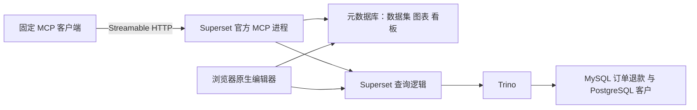

# S6：用 Superset 官方 MCP 预览、保存图表并加入看板

2026-10-18，本步实现完成，待 review，未提交。W3 和教程目录整理已提交为 `8aa1f0e`；部门隔离暂缓，尚未进入 S7 的 Codex 自然语言资产操作。

所有 shell 命令在 `deployment/008_first_bi_prototype` 执行。当前可直接打开 [S6 看板](http://192.168.2.46:8088/superset/dashboard/2/)，查看指标卡245.00、行业软件120/零售125。原看板1仍保留图表1/2/3。

## 1. 这一步补上了什么

Wren MCP 管语义模型和查询；Superset MCP 管 BI 原生资产。W3 实验中的195属于独立新口径，不会自动改写 Superset。本步沿用已核对的 S4 `net_revenue@1` 基线245。



这里没有新 Agent，也没有用自写 REST 服务冒充官方 MCP。所有资产创建、加入看板和程序化恢复都走原生工具；REST 仅用于独立读回和查找已完成的操作。浏览器保存走的是产品原生 UI。

## 2. 先查实际版本，再安装缺失依赖

Superset 6.1.0 的官方代码位于 `superset/mcp_service/`，已包含CLI和工具；精简 Web 镜像没有安装 fastmcp。首次检查 `superset/mcp/` 没找到，改查实际包目录后确认存在，不能据此误报“没有官方MCP”。

官方6.1.0包声明 fastmcp `>=3.1.0,<4`；本实验固定 `fastmcp==3.1.0`，其服务端SDK为 `mcp==1.30.0`。宿主验证客户端仍用W2的SDK1.26.0，实测可握手和调用。Wren虚拟环境没有为此升级。

| 组件 | 本步处理 |
| --- | --- |
| Superset Web | 原6.1.0镜像与进程保留，继续监听LAN的8088 |
| Superset MCP | 基于现有镜像派生独立镜像，增加40个固定包，保留166个已有依赖版本 |
| 元数据库 | 与Web共用；这是图表能在原生UI打开、编辑的原因 |
| 业务源 | 仍经Trino和只读源连接，不改源数据 |
| MCP接口 | 宿主只绑定127.0.0.1:5008，路径/mcp |

```bash
sudo docker-compose --profile mcp build superset-mcp
sudo docker-compose --profile mcp up -d --no-deps --wait superset-mcp
.local/wren-venv/bin/python scripts/discover_s6.py
```

Docker依赖锁在 [requirements.lock](../superset_mcp/requirements.lock)；Dockerfile还为已有依赖生成约束，防止安装额外包时顺带升级。最初 `uv pip freeze` 含editable的`file:///app`，不能直接作为约束；改用 [命名版本导出](../superset_mcp/freeze_constraints.py) 后构建通过。

配置来自 [superset_mcp_config.py](../superset_mcp/superset_mcp_config.py)，共享原元数据库配置。当前使用官方开发身份admin，RBAC开启，未做部门隔离。原型MCP响应缓存关闭；Explore临时预览状态与永久图表是不同存储对象。浏览器友好URL随`.env`里的`SUPERSET_BIND_HOST`注入。

官方依据：[6.1.0 MCP部署文档](https://superset.apache.org/admin-docs/6.1.0/configuration/mcp-server/)、[6.1.0包声明](https://github.com/apache/superset/blob/6.1.0/pyproject.toml)、[官方工具实现](https://github.com/apache/superset/tree/6.1.0/superset/mcp_service)。实际版本与源文件指纹见 [runtime证据](../evidence/s6-runtime.json)。

## 3. 发现工具和参数，不靠记忆猜

本步关闭工具搜索折叠，实际发现24个完整工具，见 [discovery证据](../evidence/s6-discovery.json)。固定流程主要用：

| 目的 | 实际工具 |
| --- | --- |
| 确认服务/身份 | health_check、get_instance_info |
| 读取源与配置语法 | get_dataset_info、get_chart_type_schema |
| 创建窗口固定的数据集 | create_virtual_dataset |
| 预览/保存图表 | generate_chart；save_chart默认为false |
| 读取临时或已保存状态 | get_chart_info、get_chart_data |
| 创建看板/添加图表 | generate_dashboard、add_chart_to_existing_dashboard |
| 恢复已验证图表配置 | update_chart；generate_preview=false才直接保存 |

多数工具要求 `{"request": {...}}` 外层，get_chart_type_schema直接收chart_type。工具config与Superset前端form_data不是同一种对象：例如工具输入`chart_type=xy`、`kind=bar`，保存后是原生`echarts_timeseries_bar`。

不要把所有工具的“预览”参数含义混为一谈。generate_chart需要save_chart=true才持久化；update_chart默认generate_preview=true，默认不会直接改已保存图表。

## 4. 保留失败：原生日期比较在本Trino源上不可用

先实际运行了 [s6_probe.py](../scripts/s6_probe.py)：数据集2、已保存净收入指标、日期`>=2026-10-01`且`<2026-11-01`。工具返回success=false，Trino报DATE与varchar不能比较，见 [原始失败](../evidence/s6-probe.json)。没有因此保存错误图表。

本步改用官方create_virtual_dataset创建数据集3 `008_s6_orders_october_v1`：复用S4那份订单净额SQL，在外层明确写：

```sql
WHERE order_date >= DATE '2026-10-01'
  AND order_date < DATE '2026-11-01'
```

图表对此已限定窗口的数据集按industry汇总net_amount。模型输入配置中使用SUM(net_amount)，并核对它与原数据集指标net_revenue的表达式一致。没有发明第二套净收入公式。

这是固定窗口的替代方案，不是任意日期筛选通过，也没有修复上游翻译器。S7处理动态时间问题时必须识别此限制，不能向用户假装日期条件生效。该数据集沿用S4业务SQL，不是Wren模型自动同步的产物。

## 5. 固定调用：预览 → 保存 → 加入看板 → 读回

```bash
.local/wren-venv/bin/python scripts/s6_assets.py
```

脚本先生成save_chart=false预览，确认没有新增永久chart，并通过form_data_key读取配置和120/125数据。预览URL进入原生Explore；表格或Vega预览并不等于已看见浏览器渲染，下一节单独验证UI。

接着保存指标卡和柱状图，再用指标卡创建S6专用看板，最后把柱状图加入其中。实际ID：数据集3、指标卡4、行业图5、看板2。全部写操作来自官方MCP。

| 证据 | 内容 |
| --- | --- |
| [首次创建](../evidence/s6-creation.json) | 原始工具请求、响应、保存及恢复ID演练 |
| [整条流程重跑](../evidence/s6-assets.json) | 相同资产ID，无新的持久图表/看板/数据集创建 |
| [最终状态](../evidence/s6-final-state.json) | 数据、版本、原资产、源指纹与各项验收 |

### 不能盲目重试create

本地操作记录在`.local/s6-operations.json`，脚本用文件锁避免同一台主机上并发运行，先按精确名称和已记录请求核对，再决定是否调用create。若图表params已改变，停止并保留修改，不自动覆盖。

演练中，图表已保存，但故意不先写本地chart ID；随后查询实际资产，找回同一个ID，没有重放create。这是“本地记录丢失”的受控模拟，不是真实网络断连演练，也不等于服务端提供了幂等键。

原生add工具第二次加入相同图表时返回already-in-dashboard错误；布局不变。客户端应识别已存在状态，不能把每个业务错误都当成再建一次的理由。调用错误既可能出现在协议isError，也可能在返回对象的error/success里，客户端两层都检查。

## 6. 在浏览器亲手验证

```bash
node scripts/verify_s6_browser.mjs
.local/wren-venv/bin/python scripts/restore_s6_chart.py
```

自动化使用本机已有Chrome与Playwright，执行了下面这些实际动作，不只是API检查：

1. 登录后打开未保存的Explore预览，确认柱状图渲染，数据为120/125。
2. 打开S6看板，确认245.00和两根行业柱，离开再重开仍正确。
3. 在图表5的Explore里进入Customize，把Bar orientation从Vertical改为Horizontal，Update chart后Save。
4. 在Save chart对话框使用Save (Overwrite)，重开后读取已保存配置，确认仍是horizontal，数据没变。
5. 用官方update_chart恢复最初vertical配置，再读回。没有更改原看板1。

浏览器证据：[预览截图](../evidence/s6-unsaved-preview.png)、[看板截图](../evidence/s6-dashboard.png)、[编辑截图](../evidence/s6-ui-edited.png)、[浏览器记录](../evidence/s6-browser.json)、[官方工具恢复记录](../evidence/s6-ui-restore.json)。

脚本中的Save定位最初因图标参与可访问名称匹配而超时；查看真实页面后改按按钮显示文字定位，重跑完成。未把超时写成产品不支持编辑。

正常看板1与S6看板2互相独立。你可以打开图表5的Explore查看原生数据/外观控件；如果你另行保存了修改，后续脚本会要求检查差异，不能一边保留手工变更一边无条件重置参数。

## 7. 源、语义与保存资产分别验收

```bash
sudo python3 scripts/source_db.py verify > evidence/s6-source-baseline.json
.local/wren-venv/bin/python scripts/finish_s6.py
```

源验证包含只读账号拒绝和事务回滚约束测试，需要Docker权限。S2完整数据指纹未变，正常Wren编译MDL未变；原Superset数据集2的SQL与看板1的图表1/2/3未变。

本步已经证明“官方MCP能创建原生可编辑资产”。尚未证明“Wren改口径后Superset自动同步”，也没有进入Codex的自然语言资产操作，更没有验证生产并发、真实网络失败、任意时间过滤或部门隔离。

另补齐W3的review产物：仓库全局target/忽略规则使编译快照未随上次提交纳入，现改用各版本目录中的compiled-mdl.json，并逐一核对哈希与已测MCP契约相同；W3生成器已同步改名，不改模型内容。

## 8. 停止与恢复

```bash
sudo docker-compose --profile mcp stop superset-mcp
sudo docker-compose --profile mcp up -d --no-deps --wait superset-mcp
.local/wren-venv/bin/python scripts/discover_s6.py
```

停止MCP不删除元数据库中的图表或看板。已有Web和业务源继续运行；如果整台宿主刚重启，先按原步骤恢复源库、Trino和Web，再恢复MCP。本步没有新增自动启动策略。

本步待review，不提交、不进入S7。下一步才将已验证的Superset工具交给现成Codex，重点检查意图、语义、资产定位及人工改动保留，而不是重写一个Agent。

S7还要避免语义旁路：只让分析Agent使用已审核数据集与指标，不因官方MCP存在execute_sql/create_virtual_dataset就全部开放。S6由部署者复用S4 SQL生成固定窗口，不能据此让Agent自由构造新关系。Wren执行模型与BI资产的版本映射仍需核验。

## S7 后续发现（2026-10-18）

S6 历史固定参数更新验证不涵盖全部人工样式。S7 真实多轮实验发现，原生更新保存会丢失未映射的 `color_scheme`，已保留失败并在独立 MCP 进程加入限定版本的合并适配。当前运行服务已使用该启动方式；范围、复现和限制见 [007 教程](007_S7-WALKTHROUGH.md)。这不表示原生 MCP 具备完整人工编辑保留或并发保护。
