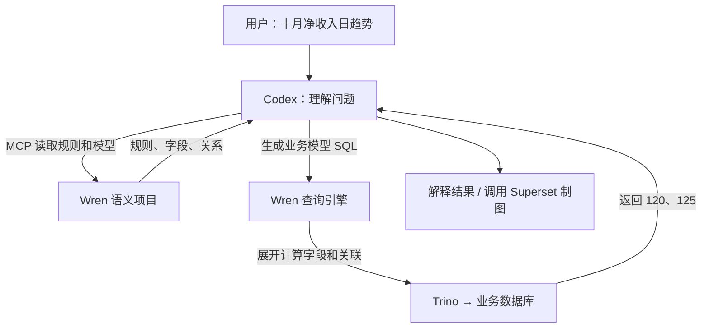

# 007 · S7：Codex 同时使用 Wren 语义和 Superset 资产

## 当前进度和学习目标

2026-10-18：S6 已提交为 `5c443ae`。**当前 S7 已完成本轮验收，待用户 review，未提交，不进入 S8。** 原有 24 个验收条目为 22 通过、2 延期；13 个独立问题均已通过。按用户追加要求，自选日期和实时源数据变化验证也已完成。中途用量中断作为历史记录保留，已不是当前阻碍。自动语义同步和并发编辑保护按用户要求暂不处理。

先理解这一步的数据流：用户用中文提出分析意图 → Codex 向 Wren 读取业务规则、规划并执行语义查询 → 核对已审核的 BI 数据集映射 → 向 Superset MCP 预览、保存、修改原生图表。没有开发新 Agent 框架。

这两个 MCP 分工不同：Wren 负责解释并执行“订单、退款、客户当前行业”的关系；Superset 负责数据集和图表资产。Superset 不会因连接了 MCP 就自动执行 Wren 模型，二者也不会自动同步。**这一步最关键的新增文件是语义到 BI 的绑定记录，而不仅是 MCP 地址配置。**

全部命令从 `deployment/008_first_bi_prototype` 执行。凭据仍通过忽略的 `.env` 和现有登录状态提供，不在本文或 Git 中保存密码。

## 先讲清楚：Codex 如何拿到 Wren 语义

当前原型中，理解中文意图、决定读取哪些信息和生成哪条查询的是 **Codex**；Wren 提供已经整理的业务定义，并将基于这些定义的 SQL 展开、校验和执行。当前链路没有两个 Agent 在对话。

### 语义存在哪里，谁维护它

| 语义形式 | 当前内容 | 文件与作用 |
| --- | --- | --- |
| 业务规则文字 | 净收入/净销售额的含义、退款归属、当前行业、不能回答的财务口径 | [general.md](../wren/knowledge/rules/general.md)，供 Codex 理解业务含义和限制 |
| 模型、字段和公式 | 每行一订单，`net_amount` 为实付减累计退款 | [订单模型](../wren/models/bi_orders/metadata.yml)，构建成引擎可执行的模型 |
| 业务关联 | 订单与退款汇总关联、客户按部门＋客户 ID 关联，声明基数 | [relationships.yml](../wren/relationships.yml)，参与模型查询展开 |
| 聚合指标 | `net_revenue` cube 的指标定义 | [指标模型](../wren/cubes/net_revenue/metadata.yml)，提供可复用的聚合入口 |

这些含义目前由我们根据实验场景编写并核对后交给 Wren，不是 Wren 从数据库自动发现并确认的。业务文字进入模型上下文不等于引擎强制执行；计算字段和关系模型才参与确定的查询展开。模型也不能替代外部数据质量校验。

### Codex 通过什么接口读取

接入 MCP 后，Codex 先知道有哪些工具可调用，再主动读取语义；不是接上地址就自动理解全部业务。第一轮实际调用如下，完整返回值见 [s7-turn-1.json](../evidence/s7-turn-1.json)：

```text
get_runtime_contract()
  → 本原型适配提供的指标版本、模型指纹和能力限制
get_instructions()
  → Wren 项目中的业务规则文字
list_models()
  → 可查询的业务模型
describe_model("bi_orders")
  → 字段说明、主键、关联条件
```

例如工具实际返回过：`net_amount` 是实付减累计退款；`industry` 是客户当前行业，缺失时为未知行业；`customer_id` 仅部门内唯一，不能单独关联。同时返回客户关联的两个条件：部门相同、客户 ID 相同。

这些文字和结构化结果通过 MCP 返回给 Codex，进入当前对话上下文。分析指令要求它先读取再写查询。除动态读取外，本实验还预置了分析流程约定和已核验的版本/数据集绑定，见 [s7/ANALYSIS.md](../s7/ANALYSIS.md)；不把预置绑定当作 Wren 自动同步结果。当前知识检索用 grep 后端，未验证向量检索。

### 用一次实际查询解释“规划和执行”

用户说“看 2026 年 10 月净收入日趋势”。Codex 读取规则和模型后，写出下面的业务模型 SQL：

```sql
SELECT order_date, SUM(net_amount) AS net_revenue
FROM bi_orders
WHERE order_date >= DATE '2026-10-01'
  AND order_date < DATE '2026-11-01'
GROUP BY order_date
ORDER BY order_date
```

`bi_orders` 是 Wren 业务模型，`net_amount` 是模型中的计算字段。Codex 不需要为这次查询重新发明退款公式或手写底层关联；Wren 已持有这些定义。随后按顺序调用：

1. `dry_plan(SQL)`：不取数，展示模型展开后的 SQL。
2. `dry_run(SQL)`：在连接的数据源上检查查询，不返回业务结果行。
3. `run_sql(SQL)`：执行模型查询，返回数据。

Wren 根据模型把查询展开为：读取订单 → 退款按部门与订单汇总 → 按已定义关系关联 → 计算实付减退款 → 按日期汇总，再通过 Trino 执行。实际得到 10 月 1 日 120、10 月 2 日 125。

因此这里的“规划”有两种：**Codex 做分析任务规划**，确定指标、时间、维度及是否需要澄清；**Wren 做 SQL 查询规划**，把已定义的业务模型展开成数据库可执行的 SQL。Wren 引擎此时接收的是模型 SQL，不是原始中文问题。[官方架构](https://docs.getwren.ai/oss/reference/architecture)



### Wren 自己有没有 Agent，能否理解自然语言

需要区分产品形态，不能把 Wren 语义引擎与完整 WrenAI 应用混称。

| 形态 | 谁理解用户问题、生成查询 | Wren 的职责 |
| --- | --- | --- |
| 本原型 Codex＋Wren | Codex | 提供语义上下文，展开、校验并执行模型查询 |
| WrenAI 完整聊天应用形态 | AI Service 配合大模型 | 结合语义上下文提供自然语言问数链路 |

WrenAI 完整聊天应用有自然语言问数能力，但底层语义引擎不等于自然语言 Agent。[官方工作原理](https://docs.getwren.ai/oss/overview/how_wrenai_works) 新版同时支持外部 Agent 消费其上下文及查询能力；当前原型采用外部 Codex 这一方式，没有部署完整聊天应用来代替 Codex。[新版架构](https://docs.getwren.ai/oss/reference/architecture)

所以目前的责任链是：业务人员与工程师整理、核实并发布语义 → Wren 保存和执行定义 → Codex 读取定义并分析。尚未实现自动从公司全部业务恢复正确语义，或自动持续同步所有变化。

## 第一步：明确已发布语义和消费映射

先阅读 [业务语义设计](../semantic-design.md)、[Wren 主项目](../wren/AGENTS.md) 和 [绑定证据](../evidence/s7-binding.json)。正常项目仍使用 `net_revenue@1`，不是 W3 独立 fixture 的 v2/195。

| 要固定的内容 | 本次实际值及作用 |
| --- | --- |
| 指标、单位 | `net_revenue@1`，人民币元；实付减累计已记录退款，不是财务确认收入 |
| 关系与粒度 | 退款先按订单聚合；客户关联含部门；最终一行一订单 |
| 时间、行业 | Asia/Shanghai 订单业务日；退款归属原订单日；客户当前行业 |
| Wren 版本 | 记录 MDL SHA256 和包含规则的 source revision，运行时必须一致 |
| BI 映射 | 数据集 3 的 UUID、数据库 ID、SQL 指纹，固定 `[2026-10-01, 2026-11-01)` |
| 对账依据 | Wren 与 Trino 执行已保存数据集 SQL，按订单键比对四行，净额为 70、75、50、50 |

实际执行过：

```bash
.local/wren-venv/bin/python scripts/prepare_s7.py
```

脚本通过真实 Wren stdio MCP 查询，并与 Trino 比对；通过原生 Superset MCP 建立 S7 专用初始指标卡和看板。随后用部署者 REST 操作加入“模拟人工备注”，这属于测试准备，不算 Agent 创建的内容。重复运行保留已有 fixture，不重置人工编辑。

输出 [s7-binding.json](../evidence/s7-binding.json) 和 [s7-fixture.json](../evidence/s7-fixture.json)。专用看板 ID 3、初始指标卡 ID 6。对人为构造的过期绑定，预检在任何 BI 写入前拒绝，见 [拒绝证据](../evidence/s7-binding-refusal.json)；这项是固定脚本测试，不是大模型问题。

**你可以学到的维护方法：** 给每个消费资产登记“业务指标版本 → 可执行模型版本 → 数据集版本”。任何一端变化都先停止沿用绑定，重新做受影响关系、指标和图表回归，再审核发布。指纹能发现变化，不能判断变化的业务含义，也不会自动改 Superset SQL。四行对账证明本 fixture 一致，不证明任意数据或任意 SQL 等价。

## 第二步：配置现成 Codex，缩小工具范围

实际执行过：

```bash
.local/wren-venv/bin/python scripts/configure_s7.py
.local/codex-bin mcp list --json
```

配置只追加到本原型被忽略的 `.codex/config.toml`，保留原有 Wren 入口，不改仓库根或用户全局配置。分析上下文生成于 `.local/s7-analysis/AGENTS.md`，来源为 [s7/ANALYSIS.md](../s7/ANALYSIS.md)、绑定和看板 ID。使用现有 Codex 0.163.0 和登录账户，继承当前模型，未覆盖模型选择。

Wren 保留现有 12 个工具；Superset 服务实际提供 24 个，但分析会话只开放 13 个：健康/实例、数据集发现和读取、图表发现/读取/数据/schema、生成/更新、加入已有看板、看板发现/读取。不开放 `execute_sql`、`create_virtual_dataset` 或 `generate_dashboard`，防止分析时绕过已确认语义自行造数据集。工具过滤只是客户端限制，不是服务端权限隔离。

最初固定窗口分析上下文保留供回归。当前交互入口已切换为全日期数据集 2，启动时校验日期绑定并生成 `.local/s7-date-analysis/AGENTS.md`；详见后文日期扩展。交互练习入口：

```bash
sh scripts/analyze_s7.sh
```

该入口关闭 shell、unified_exec 和 multi_agent，使用文件只读沙箱。文件只读不等于 MCP 只读，保存图表仍有外部副作用。研究身份为本地 admin；MCP 仅监听 `127.0.0.1:5008`。部门隔离随 S5 暂缓，不宣称适合直接给全公司使用。

配置说明依据 [Codex 官方 MCP 文档](https://developers.openai.com/codex/mcp) 和 [非交互执行文档](https://developers.openai.com/codex/noninteractive)，实际加载证据见 [s7-config.json](../evidence/s7-config.json)。

## 第三步：真实多轮对话，而不是固定脚本代替模型

实际分别执行过四个逻辑步骤；通过 `exec resume` 复用同一个 Codex 会话，第三步保留原生失败并修复后重试，因此共执行五轮模型调用。

```bash
.local/wren-venv/bin/python scripts/verify_s7_codex.py --turn 1
.local/wren-venv/bin/python scripts/verify_s7_codex.py --turn 2
.local/wren-venv/bin/python scripts/verify_s7_codex.py --turn 3
.local/wren-venv/bin/python scripts/verify_s7_codex.py --turn 4
```

| 逻辑步骤 | 实际行为 | 可核对结果 |
| --- | --- | --- |
| 1：十月净收入日趋势，保存到指定看板 | 29 次 MCP 调用；读取运行契约/规则、规划/执行查询、预览、保存、加入并读回 | 图表 7，120/125，合计 245 |
| 2：再按当前行业比较并保存 | 26 次调用；真实语义查询和原生图表操作 | 图表 8，软件 120、零售 125 |
| 3：改成横向，保留人工修改和其他资产 | 原生路径失败；安装下节适配并恢复测试准备后，同一会话重试 18 次调用 | 只修改图表 8 的方向；名称、金额格式、行数 77、配色保留 |
| 4：重复保存同一行业图 | 4 次读取，无创建、更新或重复加入 | 复用原 ID，看板仍只有 6/7/8 |

每步证据为 `evidence/s7-turn-1.json` 至 `s7-turn-4.json`，保存工具参数、工具结果和最终结构化回答，不保存推理内容。验证器会读实际原生资产，不单独相信模型最后的文字。第一次没有使用虚拟环境，因缺少 `httpx` 导入失败；正确命令始终使用上述 venv Python。

已通过的步骤禁止重复执行，以免制造新图。仅修改证据解析时，可使用 `--collect-only` 重读本地原始事件，不重放写入。`.local/s7-main-session.json` 保存当前会话和完成进度，原始事件在被忽略的 `.local/` 中。

## 第四步：为什么原生更新失败，以及适配解决了什么

第三步前，部署者模拟用户修改行业图：名称改为“008 S7 行业净收入（模拟人工改名）”，金额格式 `,.1f`、行数 77、配色 `d3Category10`。见 [模拟编辑](../evidence/s7-manual-edit.json)。这些是明确登记的测试准备，不是声称用户实际操作过 UI。

Superset 6.1.0 当前 MCP 的更新保存路径重新构造 `params`，与预览合并路径不同。它保存成功，却丢失没有映射到输入 schema 的 `color_scheme`。模型读回后发现问题，尝试传配色时又被输入校验拒绝，最终如实说明无法保留。验证器也因配色缺失失败，详见 [原生失败](../evidence/s7-native-update-failure.json)。这无法靠要求模型“更仔细”解决。

本步加入 [start_mcp.py](../superset_mcp/start_mcp.py)，只在独立 MCP 进程中包装原生 `_build_update_payload`：相同图表类型时，将新参数合并到最新已有参数。保留原生工具、身份检查和保存命令，没有新增自研 MCP 工具，没有改 Web 镜像或已安装包。启动校验 Superset/FastMCP 版本以及原生源文件 SHA；升级变化时拒绝启动，要求重新审核。不同图表类型的替换直接拒绝，因为未验证其兼容性。

实际修改 Compose，挂载该文件并将 MCP 启动命令改为 `python /app/pythonpath/start_mcp.py`，随后执行：

```bash
sudo docker-compose --profile mcp up -d --no-deps --wait superset-mcp
```

恢复模拟人工状态后再重试第三轮，恢复前后状态单独记录于 [s7-fixture-restore.json](../evidence/s7-fixture-restore.json)，没有在验证后偷偷修图。重试只改方向，所有原有非方向参数逐项一致。

此适配只补齐未映射字段的保留；已有映射字段仍需模型先读取最新值再传入。**没有修订号比较或乐观锁，不能保证读后发生的并发人工修改不会被覆盖。** 目前不支持跨图表类型更新。要恢复原生行为，可移除 Compose 的该挂载和启动命令，恢复 S6 原生启动配置后只重建 MCP；这样会重新暴露已知样式丢失问题，不要据此宣称回归通过。

## 第五步：独立问题集与补测结果

实际运行：

```bash
.local/wren-venv/bin/python scripts/verify_s7_cases.py --case all
```

[questions.json](../s7/questions.json) 定义 13 个独立问题，每题新建真实 Codex 会话；除表/指标卡预览允许无保存的 `generate_chart` 外，关闭资产写入工具。当前 13 题均通过，原有通过项没有重放。

前七题覆盖：净销售额同义词、含糊收入澄清、财务确认收入不可冒充、本月边界解释、无订单与零收入区分、缺少毛利口径、缺少历史行业关系。相对月份一题是模型按固定基准日解释边界，实际 0 次 MCP 调用，不算数据库查询。

第八题最初在 Wren 返回四行后遇到 CLI 用量中断，当时没有生成预览。见 [中断历史](../evidence/s7-case-details_preview-blocked.json)。本次已重跑并完成，不再作为待办。

| 本次补齐问题 | 实际结果 |
| --- | --- |
| Q16 明细表 | Wren 四行 70/75/50/50，与原生表预览及浏览器四行一致；10 次 MCP 调用 |
| Q17 指标卡 | Wren 合计 245，生成原生无保存预览，浏览器显示 245.00；10 次调用 |
| Q18 缺失客户规则 | 解释保留订单、归为未知行业，不查询或伪称发现了缺失客户；4 次调用 |
| Q19 退款扇出 | 解释先汇总退款的粒度要求，并真实查询合计 245；12 次调用 |
| Q20 超出旧固定窗口 | 核查十一月无订单，拒绝把十月数据当作十一月保存；7 次调用。该题保留固定数据集 3 的历史回归，不限制后续全日期入口 |
| Q21 财务口径覆盖 | 明确缺少确认收入定义、拒绝覆盖，模型报告 unchanged；2 次调用，无查询和资产写入 |

Q21 最初验证器只接受 unavailable/needs_clarification，实际模型用 unchanged 明确表达“不能执行、没有改动”。已调整状态枚举，并加强缺少定义/拒绝文字和无写入断言；用 `--collect-only` 读取原始回答，没有另跑模型来迎合断言。缺失客户题只检查规则解释，不是新建 S7 缺失客户 fixture；此前 W1 数据回归另有证据。

[case-catalog.json](../s7/case-catalog.json) 的 24 项不是 24 个独立问题：主对话覆盖 8 项，独立问题 13 项，过期绑定固定测试 1 项，延期 2 项。当前为 **22 通过、0 阻断、0 待测、2 延期**。真实网络断连恢复和随 S5 延期的权限测试没有冒充通过。日期扩展另列证据，不混入原 24 项凑数。

## 第六步：浏览器和数据回归

先执行过部分审计，随后已完成完整检查：

```bash
node scripts/verify_s7_browser.mjs --dashboard-only
sudo python3 scripts/source_db.py verify
.local/wren-venv/bin/python scripts/finish_s7.py --partial
```

独立 Playwright 浏览器登录，核对图表数据请求和实际画布，离开并重开看板再次核对：总额 245、趋势 120/125、行业 120/125、横向柱状图和人工备注保留。见 [浏览器证据](../evidence/s7-browser-dashboard.json) 和 [截图](../evidence/s7-dashboard.png)。模型没有直接看图；这里由独立浏览器检查渲染。

本次截图保留了测试指标卡原有的大字号人工备注，目的在验证保留，不作为正式看板排版建议。随后已执行 `node scripts/verify_s7_browser.mjs`，独立核验新明细表与指标卡预览，见 [完整浏览器证据](../evidence/s7-browser.json)、[明细截图](../evidence/s7-details_preview.png)、[指标卡截图](../evidence/s7-kpi_preview.png)。明细原生表将整数显示为 70/75，最初浏览器检查误要求 70.00/75.00；修正为等价数值显示，同时核对四行原始数据。

源数据快照仍为 S2 的 `f5f457e68edf6080470a01c093bb4be2cc23d3a08c337af6446ffae446a750f8`。六个容器健康，MCP 启动日志含适配标记；详见 [源数据](../evidence/s7-source-baseline.json)、[服务状态](../evidence/s7-services.json)。原看板 1 的图表 1/2/3、S6 看板 2 的图表 4/5 和 S4 数据集 SQL 未变化。

`finish_s7.py --partial` 是中途部分审计，[进度状态](../evidence/s7-progress-state.json) 保留为历史快照。当前已实际运行 `.local/wren-venv/bin/python scripts/finish_s7.py`，要求全部未延期项目、两类预览和日期扩展证据齐全；输出 [最终状态](../evidence/s7-final-state.json) 与更新后的 [逐项结果](../evidence/s7-case-results.json)，`stage_complete=true` 表示本轮范围验证完成，不表示生产能力或延期项目通过。

## 亲手检查与排错顺序

打开 [S7 看板](http://192.168.2.46:8088/superset/dashboard/3/)，先对照四笔订单的手算答案，再看横向行业图、已有备注和日趋势。正式修改前先读当前资产；不要把输出的整个 `form_data` 当作工具支持的输入 `config`，两者 schema 不相同。

如果合计错，先查指标版本、时间边界和退款聚合；如果行业错，再查客户联合键和当前/历史定义；如果数字正确但图变了，查保存前后参数；如果版本指纹不一致，停止写资产并走语义发布回归。**不用重建一个 Agent 来替代这些业务检查。**

目前能回答的是：小 fixture 中，Codex 能消费显式语义，再操作已绑定的 BI 资产。自选业务日期筛选已在下节扩展完成；仍未证明自动发现公司所有业务关系、自动维护跨工具语义、大数据性能或生产权限。S8 等本步 review 和确认提交后再开始。

## 本轮验收范围与延期项

原来未完成的 Q16～Q21、明细/KPI 浏览器渲染和完整终验均已完成，结果见第五、六步与最终状态。用户追加的自选日期需求见后文，本次也已完成。

仍不计为通过的项目：真实网络断连与保存结果不明后的恢复（Q23）；按用户要求延期的部门越权、敏感列、撤权与缓存隔离（Q24/S5）。自动语义同步和并发编辑保护按用户最新要求暂不处理；大目录/大数据实验属于后续 S8。当前未部署完整 WrenAI 聊天应用。

## 三个问题的含义与最新处理

| 问题 | 具体触发场景 | 现有处理和后续需要 |
| --- | --- | --- |
| 自动语义同步 | Wren 将净收入从实付减全部退款改为只统计特定订单状态，但 Superset 数据集 SQL 仍按旧规则计算 | 当前指纹预检会拒绝继续沿用旧绑定，但不会自动改数据集或旧图表。需要受影响资产清单、生成或更新消费 SQL、数据回归、审核发布与回退流程 |
| 任意日期范围（本次已处理业务 DATE 范围） | 用户要求九月、全年或自选日期，而旧数据集 3 固定十月 | 当前交互入口改用全日期数据集 2，支持校验后的起止日期和看板原生日期筛选；单日、跨月、全年、空区间及实时变化已验证。未扩展小时/分钟级 timestamp 或大数据扫描成本控制 |
| 并发编辑保护 | Codex 先读取图表；用户随后改了颜色或名称；Codex 再按旧状态保存 | 当前合并适配保留服务端已有的未映射字段，但没有读写版本检查，映射字段仍可能被旧值覆盖。需要修订号或内容指纹比较，并由服务端原子检查与保存；冲突时重新读取或交由用户处理，不能只靠保存前多读一次 |

这些问题不同于六个独立验收题。本次补题之外追加完成了业务日期范围；自动同步和并发编辑保护按用户要求暂不处理。自动同步尤其需要与业务审核结合：发现规则变化不等于已经确认新规则正确，也不应该未经审核批量重写全部看板。

## 第七步：自选日期与实时数据（用户追加，本次已完成）

### 为什么不再新建每月数据集

旧数据集 3 是 S6 原生日期比较失败后的固定十月绕行，只保留作历史回归。当前使用现有全日期数据集 **2**，复用其已核验的一行一订单 SQL，不写固定日期，也不保存预计算金额。十月只是图表/筛选器的初始范围；源数据新增或变化后，重新查询即可读取当前数据。

新看板为 [008 S7 自选日期与实时数据](http://192.168.2.46:8088/superset/dashboard/4/)，指标卡/趋势/行业图 ID 分别为 9/10/11。原看板 1、S6 看板 2、S7 多轮看板 3 保留不改。

### 日期错误在哪里，如何修正

实际探测发现：Superset 自身原生时间范围会生成 `order_date >= DATE '2026-10-01' AND order_date < DATE '2026-10-02'`，能正确返回 120；MCP 通用比较筛选却把日期当作 varchar，发生类型错误。

在已有 [MCP 进程适配](../superset_mcp/start_mcp.py) 中增加限定范围的日期映射：仅对已核验的数据集 2、`order_date`，接受 config.filters 中 `>= start` 和 `< end` 两个 YYYY-MM-DD 边界。校验真实日期和 start < end，转换为原生 `TEMPORAL_RANGE`，没有接收用户原始 SQL，没有新建 Agent 或额外 MCP 工具。原生 chart_utils 文件也固定 SHA，升级后必须重新审核。

第一次只映射 adhoc_filters/time_range，MCP `get_chart_data` 的未保存预览读取路径没有消费这些条件，导致单日应为 120 却返回整月 245。逐源对账拦住错误，进一步将同一条件写入 QueryObject filters，完成预览读取的一致映射。容器重启后立即连接还出现一次 ReadError，改为等待服务 healthy 后再测试；这不是 Q23 的真实网络故障恢复验证。相关实际失败见 [补测失败记录](../evidence/s7-completion-failures.json)。

### 已实际执行的操作与结果

```bash
sudo docker-compose --profile mcp restart superset-mcp
sudo docker-compose --profile mcp up -d --no-deps --wait superset-mcp
sudo .local/wren-venv/bin/python scripts/verify_s7_dates.py
.local/wren-venv/bin/python scripts/configure_s7_dates.py
.local/wren-venv/bin/python scripts/verify_s7_date_codex.py
node scripts/verify_s7_dates_browser.mjs
sudo python3 scripts/source_db.py verify
.local/wren-venv/bin/python scripts/finish_s7.py
```

日期脚本由部署者执行，需要 Docker 权限；普通 Codex 分析会话没有修改源数据的工具。测试调用原生 MCP 创建新图表/看板，REST 配置原生日期筛选元数据，并为新趋势图开启单点标记，避免只有一天数据时折线看起来为空。生成 [全日期绑定](../evidence/s7-date-binding.json)、[日期资产](../evidence/s7-date-assets.json)、[日期回归](../evidence/s7-dates.json)。全日期绑定沿用同一指标、MDL 和规则 revision，但登记数据集 2 的 UUID/SQL 指纹，不覆盖历史固定窗口绑定。

| 场景 | 实际结果 |
| --- | --- |
| `[10-01,10-02)` / `[10-02,10-03)` | 120 / 125，结束日不包含 |
| 九月 / 十一月 | 无订单，合计 NULL，不冒充零收入 |
| `[09-01,11-01)` / 2026 全年 | 245 / 245 |
| 临时将订单 2 日期改到 09-30，实付 80→90 | 九月 85、十月 170、跨月 255；Wren 与 MCP 实际数据一致 |
| finally 恢复订单 2 日期和金额 | 十月恢复 245；完整源快照与 S2 指纹一致 |
| 倒置日期、2 月 30 日 | 拒绝生成预览，不保存错误资产 |
| 真实 Codex：“只看 2026 年 10 月 2 日，按当前行业比较” | 11 次 MCP 调用；Wren 合计 125；数据集 2 的原生日期预览只含零售 125，无保存 |
| 浏览器操作左侧日期控件 | 单日 120/125、九月空数据、跨月 245，指标/趋势/行业均响应 |

日期按 Asia/Shanghai 业务 DATE 解释，不是 UTC timestamp 换算。区间统一起含止不含；查看 10 月 2 日应选择 10-02 到 10-03。新趋势图启用 markerEnabled/markerSize，以便单日只有一个点时仍可见；这是部署者的展示配置，未改指标。[Superset 图表实现](https://github.com/apache/superset/blob/master/superset-frontend/plugins/plugin-chart-echarts/src/Timeseries/transformProps.ts) 当前验证日级范围，未实现小时/分钟级精度或生产扫描成本限制。

### 你可以亲手验收

1. 打开新看板，初始净收入为 **245.00**。
2. 左侧“业务日期（起含止不含）”设置 2026-10-02 到 2026-10-03，应用日期，再点 Apply filters；应为 **125.00**，行业仅零售，趋势仅这一天。
3. 改为 2026-09-01 到 2026-10-01：当前恢复后的基线没有九月订单，应显示无数据。改为 09-01 到 11-01：应为 **245.00**。
4. 通过 `sh scripts/analyze_s7.sh` 启动现有 Codex，问“只看 2026 年 10 月 2 日的净销售额，按行业预览，不保存”。当前入口先校验全日期绑定，生成新分析上下文，默认使用数据集 2，不再默认使用固定十月数据集 3。

浏览器截图：[默认范围](../evidence/s7-date-dashboard.png)、[单日范围](../evidence/s7-date-single-day.png)、[真实 Codex 预览](../evidence/s7-date-codex.png)。完整依据见 [浏览器验证](../evidence/s7-dates-browser.json)、[实际模型调用](../evidence/s7-date-codex.json)。业务数据变化测试已恢复，不把临时 255 留给用户验收。

重复运行时复用专用资产 ID，不生成重复看板。需要完全恢复 S6 原生 MCP 启动时，两个兼容能力都会消失：样式保留和日期映射必须重新回归。自动语义同步、并发修改保护仍暂不处理，不影响明确展示本次日级日期能力的实际范围。
