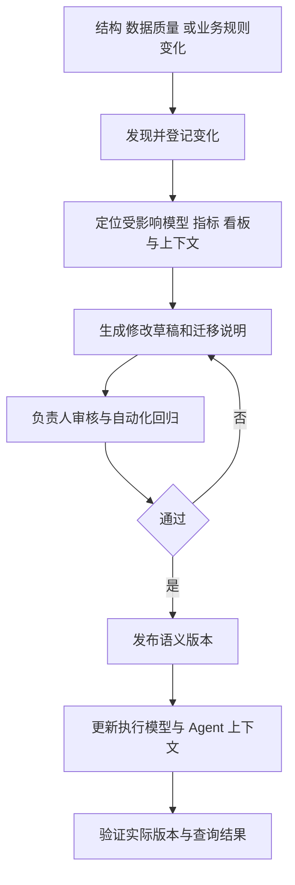

# 业务语义维护与变化同步：已有工具如何分工

日期：2026-10-16。本文根据前期工具调研，重新围绕“如何长期维护业务关系、指标及其变化”整理选型。能力说明来自已查阅的官方资料，组合方案和实验顺序属于工程建议；尚未部署验证，不代表已修改或批准部署计划。

2026-10-18 实验更新：当前已完成 Superset/Trino 基线、Wren 建模及 Codex/MCP；W3 独立语义维护演练已提交；S6 已提交，当前 S7 完成本轮验收（待 review），并验证自选日期与实时源变化。下文工具能力比较保留原调研日期，实际实现以 [008 操作记录](../../deployment/008_first_bi_prototype/README.md) 为准。部门隔离暂缓。

相关文档：[存量业务接入](09-existing-business-semantic-onboarding.md)、[语义层总体调研](agent-semantic-research.md)、[首个 BI 原型](08-first-bi-prototype.md)。

## 1. 研究重点为什么变化

对于让 Agent 长期可靠地理解公司业务的目标，业务语义及其持续维护比第一轮选择哪款 BI 更关键。BI 仍然决定编辑、保存、共享和权限等产品能力，但无法独自保证“收入怎么算、关联哪个客户、哪些订单有效”。

要维护的内容包括物理结构、实体关系、指标口径以及负责人、来源、版本和授权范围。表结构只是其中一层。造数实验已知关系，适合校验执行链路；存量实验还必须验证关系发现、审核和变更发布。

## 2. 哪些工具正面解决这个问题

| 工具 | 业务语义与关系 | 变化后的维护方式 | 不能直接承诺的能力 |
| --- | --- | --- | --- |
| Wren 新版 / MDL | 定义模型、字段、关系、计算字段和业务知识，供 Agent 发现与查询 | 维护版本化模型，修改后重新构建；使用检索时更新索引，运行回归 | 自动生成草稿不能确定权威表、状态含义或全部业务规则；不自动完成整条治理闭环 |
| Cube | 集中定义指标、维度、关联、预聚合和访问策略，通过统一查询入口复用 | 更新并发布模型，验证查询及缓存/预聚合受影响范围 | 统一计算不等于自动发现业务语义变化 |
| dbt＋MetricFlow | dbt 整理数据转换模型；MetricFlow 使用实体、维度及指标定义组织语义查询 | 将修改纳入代码 review、构建、测试和发布流程 | dbt Core 不等于完整平台 Semantic Layer；具体语法、连接器与消费能力需固定版本核实 |
| Lightdash | 在模型配置中维护指标和维度，直接服务 BI 图表与看板 | 模型代码、开发预览和部署流程帮助验证修改 | 更偏向 Lightdash 分析体系；不能将其 Agent/MCP 商业能力算作免费核心 |
| OpenMetadata | 管理元数据、血缘、质量检查与数据契约，帮助整理资产及约束 | 通过持续采集、质量和契约检查辅助发现结构/数据偏离，结合血缘分析影响 | 不是指标执行引擎；采集或告警不会自动修正并发布 Wren/Cube 等模型 |

Wren 文档描述了从数据库生成模型草稿、review、构建及索引的流程，也明确指出脚手架不能自动确定权威表和业务状态含义。[官方建模说明](https://docs.getwren.ai/oss/guides/model)

Cube 模型包含指标、维度、关联、预聚合及访问策略。[官方模型说明](https://docs.cube.dev/reference/data-modeling/cube)

dbt 的语义模型是 MetricFlow 组织语义查询的基础；应区分数据转换模型、语义定义及平台提供的消费接口。[官方语义模型说明](https://docs.getdbt.com/docs/build/semantic-models)

Lightdash 文档介绍指标配置及开发预览，可用于在生产项目之外验证修改；自托管 Agent/MCP 的授权边界需单独检查。[指标与开发预览](https://docs.lightdash.com/get-started/setup-lightdash/how-to-create-metrics)、[企业功能](https://docs.lightdash.com/self-host/enterprise-features)

OpenMetadata 的采集框架包含元数据、血缘、使用情况、Profiler 和质量工作流；数据契约可以表达 schema、语义要求和质量测试，并追踪执行记录。不同版本、连接器的支持范围需实际验证。[采集框架](https://docs.open-metadata.org/latest/deployment/ingestion)、[数据契约](https://docs.open-metadata.org/v1.11.x/how-to-guides/data-contracts)

## 3. 哪些工具主要承担其他职责

| 前期调研工具 | 在整体系统中的主要职责 | 与本次核心问题的关系 |
| --- | --- | --- |
| Superset、Metabase | 数据集、指标、图表、看板和访问管理 | 有一定语义能力，可作消费与验收入口；前期尚未证明覆盖跨系统语义治理 |
| Trino、DuckDB | 查询与计算 | 执行查询不等于决定业务口径或维护语义版本 |
| SQLBot、DB-GPT、Vanna | 问数或 Agent 能力 | 能利用上下文，不据此认定具有完整语义变更治理 |
| LangGraph、Dify | 流程编排 | 可编排审核和调用，但不会自动提供正确的业务定义 |
| json-render、Flint | 展示与界面生成 | 消费结果及展示配置，业务关系仍需另外定义 |

这是按本项目已研究范围做的职责归类，不是对所有版本功能的穷尽判断。原始证据与边界见 [语义层总体调研](agent-semantic-research.md)、[Cube 路线](03-cube-trino-custom-bi.md)、[Lightdash 路线](04-lightdash-trino.md) 和 [Wren 独立分析](07-wrenai-analysis.md)。

## 4. “变化同步”由什么组成

| 变化类型 | 例子 | 主要发现途径 | 后续动作 |
| --- | --- | --- | --- |
| 结构变化 | 字段改名、类型改变、增加表 | 元数据采集与 schema 差异比较 | 定位依赖模型，修改映射并验证 |
| 数据特征变化 | 客户键出现重复，历史有效期重叠 | 唯一性、关联基数、完整性等质量检查 | 阻止不合格模型发布，定位数据或关系问题 |
| 业务含义变化 | 有效订单增加一个状态；收入改为不含税 | 业务需求、应用变更及负责人审核 | 更新口径、版本和测试，决定旧版本迁移方式 |

结构不变并不代表语义不变。定时扫描数据库无法可靠推断业务决策，所以“自动发现变化”与“自动接受变化”必须分开。

数据刷新与语义发布也应分开：新增订单通常只需刷新查询；修改净收入公式需要更新语义模型及依赖，并验证后发布。

建议闭环：

目录采集、语义编译、索引更新和 BI 资产更新通常不是一个原子事务。要记录各消费端实际使用的版本；更新不完整时不能宣称同步完成。失败时可暂停发布或回退到兼容版本，但底层 schema 已不兼容时，仅回退模型文件可能无法恢复服务。

## 5. 面向当前项目如何选

当前要求是不从头开发 Agent，使用 Codex 接入 MCP。因此建议优先研究 **Wren 新版的建模、查询及变更维护链路**，重点验证它能否承载已审核业务关系，并让 Agent 使用正确版本。该建议不意味着已确认 Wren 与现有 Trino、Superset、身份体系全部兼容。

OpenMetadata 作为持续发现变化和资产治理的候选，在实际出现大量库表、来源和依赖维护困难时引入。小范围试验可以先使用 schema 快照和质量断言，不需要为验证一个关系就部署完整目录平台。

Cube 和 MetricFlow 是统一语义执行方向的候选；应根据多消费端指标复用、既有 dbt 流程、连接器与运维约束比较，而不是与 Wren 同时维护同一套指标。Lightdash 适合作为语义与 BI 结合的路线对照。

首要设计原则：**为每项业务定义选定一个权威维护位置，其他地方引用或生成派生配置。** 避免在 Wren、Cube、Superset 和提示词中手工复制四份净收入公式。即使需要多个消费端，也要明确映射、版本和一致性验证。

Superset 保留为可编辑资产与结果验收入口；Trino 保留为跨源执行候选。如何将语义模型计算结果接入 Superset，以及是否存在绕过语义模型的查询路径，都需要单独验证。

## 6. 下一项更有价值的实验：主动改变业务关系

在基础查询正确后，增加一次关系变化演练，检验维护能力，而不只检验首次建模。

| 阶段 | 实验动作 | 预期证据 |
| --- | --- | --- |
| 初始状态 | 独立 fixture 中客户 ID 全局唯一，模型按 customer_id 关联 | 初始数据、模型版本及基准结果 |
| 制造变化 | 新部门引入重复客户 ID，使 ID 只在部门内唯一 | 唯一性或关联行数检查失败；原 JOIN 可能放大金额 |
| 定位影响 | 找出客户关系及依赖的指标、查询和看板 | 受影响清单，注明自动发现和人工补充部分 |
| 修正草稿 | 将关联改为 `(dept_id, customer_id)`，更新粒度与质量约束 | 可 review 的模型差异，不静默覆盖 |
| 发布验证 | 审核并回归后发布，更新检索上下文和执行模型 | 新模型正确对账，Agent 关联路径正确，各入口版本一致 |
| 失败演练 | 模拟模型已更新但上下文索引未更新 | 能发现版本不一致并停止错误查询，或明确记录缺口 |

这组 fixture 独立于 008 原型的 245 基准：原型本来就规定客户 ID 仅部门内唯一，不能把该原始设定误写成后续新变化。

再补一项“schema 不变、口径变化”的实验，例如有效订单状态集合变化，检验业务审核和版本发布路径。该项不能以 schema 扫描成功作为验收通过。

本阶段最重要的指标是：错误能否被发现、影响范围能否解释、人工审核工作量、发布后各入口是否一致，以及失败是否可定位。仅证明配置文件可编译或 MCP 能连接，不算维护闭环通过。

## 7. 当前决定与未决项

- 已明确研究重心：业务语义的建立、维护、变化发现与发布一致性。
- 候选优先级建议：Wren 语义链路优先，OpenMetadata 按目录治理需要加入；不同时引入全部工具。
- 未验证：固定版本兼容、真实源连接、变更检测覆盖、身份隔离、语义到 BI 的映射和跨组件同步。
- 未改变：部署仍按用户逐步 review、确认后提交的约定执行。调整具体部署顺序，应先修改计划并交付 review；本文不作为已批准启动新组件的记录。

## 8. W3 实测：语义维护主线已开始验证

2026-10-18，沿用本页第6节的独立fixture方案完成实验，具体步骤见 [W3教学与操作](../../deployment/008_first_bi_prototype/walkthroughs/005_W3-WALKTHROUGH.md)。尚未连接公司业务数据，不能将合成实验写成已恢复公司语义。

| 待解决的问题 | 实际观察与当前处理 |
| --- | --- |
| 表结构没变，关系为什么会坏 | 客户ID从全局唯一变为部门内唯一；类型/字段不变，唯一性检查发现2组重复 |
| 为什么不只检查总额 | 总额查询裁掉客户JOIN仍为245，行业查询却得240/250合计490，明细变8行 |
| 正确关系怎样落实 | 更新客户主键与关联为部门＋客户ID，回归恢复4行、245、120/125 |
| 业务政策怎样同步 | 数据和schema相同，适用状态paid/settled→paid，发布net_revenue@2，结果195 |
| Agent怎样使用正确版本 | 模型、规则、示例同包，检查文件指纹；切换后旧会话拒绝查询，新Codex实际使用v2返回195 |
| 发布出错怎么办 | 混合规则/模型拒绝；回退到旧版本245，再恢复v2的195 |

组织语义时先按分析主题区分术语、实体身份和粒度，再定义有业务角色的允许关系、基数、缺失和历史规则，最后定义指标。业务关系不是从字段同名或外键自动得出的事实。每条关系要有证据、校验和负责人；本次只有实验审核记录，没有真实业务负责人确认。

目前从MDL提取模型/cube影响范围；知识和示例依赖由本实验登记，Superset对应业务资产人工映射。没有自动血缘平台、定时变化采集或生产发布服务。grep检索的长问题未命中也已记录，不能把“重新index”当作解决所有上下文同步问题。

这次回答了维护链路如何验证；下一次接公司存量业务时，应使用 [存量接入流程](09-existing-business-semantic-onboarding.md) 收集DDL、代码/状态规则、已有报表和确认依据，从一个具体业务问题开始。Wren执行已确认关系，Codex帮助整理和消费，实际业务含义仍须核实。

## 9. S7 实测：语义发布后还需要消费绑定

2026-10-18，Codex 已在同一对话通过 Wren 查询，再通过 Superset MCP 保存日趋势/行业图并修改方向。流程和实际阻碍见 [007 教程](../../deployment/008_first_bi_prototype/walkthroughs/007_S7-WALKTHROUGH.md)。当前 13 个独立问题已通过，原 24 个验收条目中 22 通过、2 明确延期；新增日期验证另列证据。

本次将 `net_revenue@1`、MDL 指纹、规则 revision 绑定到 Superset 数据集 UUID/SQL 指纹，并在四行 fixture 上逐订单比对；过期绑定在写图前拒绝。这个实验补上“Agent 使用哪个已发布语义，对应哪个 BI 资产”的明确依据。指纹检查由部署验证器实施，不是 Superset 自动执行的全局语义权限控制。

因此维护关系需要同时处理两类变化：源表/业务规则变化后的模型回归发布，以及下游消费映射的重新核验。Wren 能执行已定义关系；本实验尚无自动将 Wren 变化传播到 Superset 的机制。接入公司业务时仍要登记关系负责人、基数/粒度、历史和缺失规则，并将受影响数据集/指标/看板纳入发布检查。仅接 MCP 或保存一份 schema 都不能替代这条维护链路。

资产工具本身也有兼容边界：当前版本原生更新丢失未映射样式，本步以固定版本的小适配保留同类型参数，并保留失败证据；没有并发修改保护。不要把数据语义正确、图表更新成功和生产发布安全混为一个通过结论。

S7 后续按用户要求补齐日级自选日期：消费映射新增全日期数据集 2，时间范围在查询时传入，固定十月仅保留作旧基线。单日、空区间、跨月、全年及源数据变化均经 Wren/MCP 对账和浏览器验证。此项解决的是消费时间范围，不等于模型变化自动发布；自动语义同步、并发编辑保护本次按用户要求暂不处理。当前验收看板及复现见 [007 日期扩展](../../deployment/008_first_bi_prototype/walkthroughs/007_S7-WALKTHROUGH.md)。

## 10. S8 实测：增长后优先维护什么

S7 已提交 `1b0f9ec`，S8 本轮研究完成、待 review，详细过程见 [008 · S8 教程](../../deployment/008_first_bi_prototype/walkthroughs/008_S8-WALKTHROUGH.md)。实验仍是合成数据，没有接入公司实际业务。

1 万/10 万/100 万订单，Wren 可执行模型的总额、行业和日趋势均与独立整数分账本一致。百万档单并发后续 5 轮中位为 1.44/1.81/0.91 秒，达到预声明 5 秒探索目标；这是单机 PostgreSQL→Trino 实验，不代表多源并发生产容量。

目录由 10 增到 100、500 个模型时，真实 MCP full-schema 文本从 1493 增到 16505、83225 字节。500 模型中仅 7 张实验业务表，其余为空 stub 的噪声别名；不是 500 张真实业务表的接入测试。当前 grep 后端没有按主题缩小上下文，不宣称检索问题已解决。

500 模型下保持 MDL、工具、数据和模型配置一致，仅改变业务规则文本，三个问题各两次：schema-only 六次均要求澄清；schema＋审核规则六次均查询正确，包括当前/历史行业、重叠标签。这证明本 fixture 中显式规则可被现成 Codex 消费，不证明规则自动生成或稳定泛化正确率。

面向公司业务，建议按分析主题维护：实体身份和粒度 → 关系角色及联合键 → 基数/缺失/历史区间 → 标签分配与可加性 → 指标版本/单位/时间 → 负责人、证据与回归。当前行业和下单时行业必须是两条有名字的路径；标签组可重复计入，不能相加为总额。实际错误关联对照返回 1065、1650、1110，而基础总额为 865，不能只维护“这些表存在 JOIN”。

当前用可测试关系契约即可表达上述语义，未遇到必须用形式化本体推理的需求，因此不新增本体或图数据库。后续若出现跨业务概念映射或推理需求，应针对具体问题对照验证。自动语义同步、并发资产保护和部门隔离继续按用户要求暂缓。
